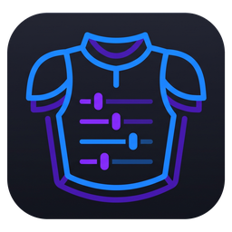
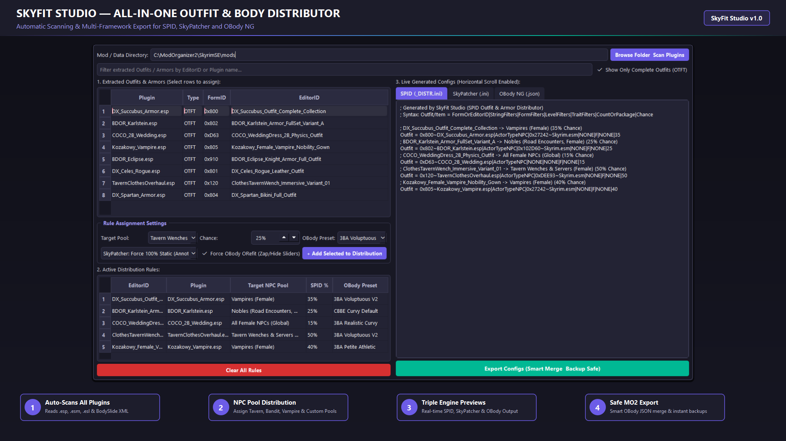
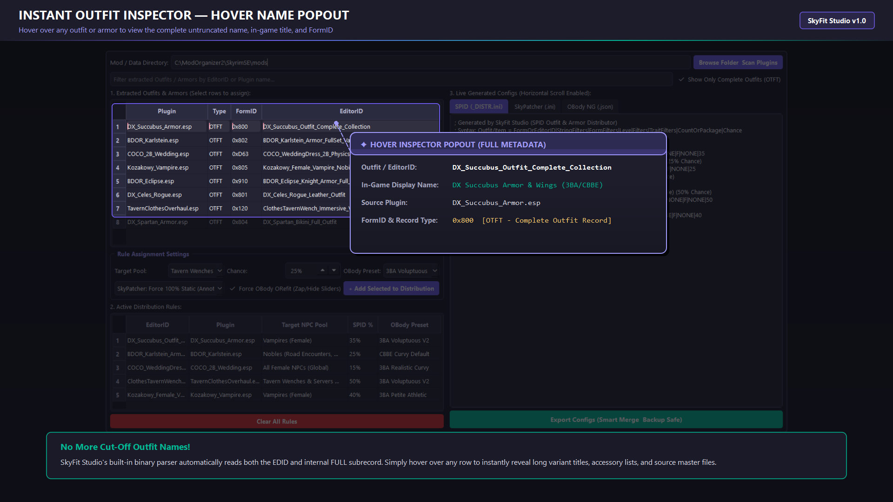
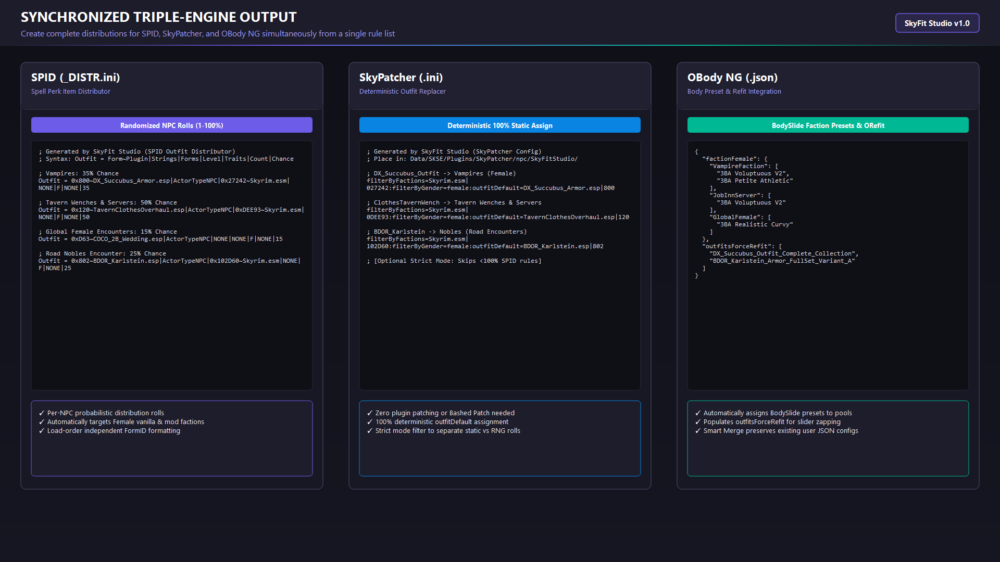
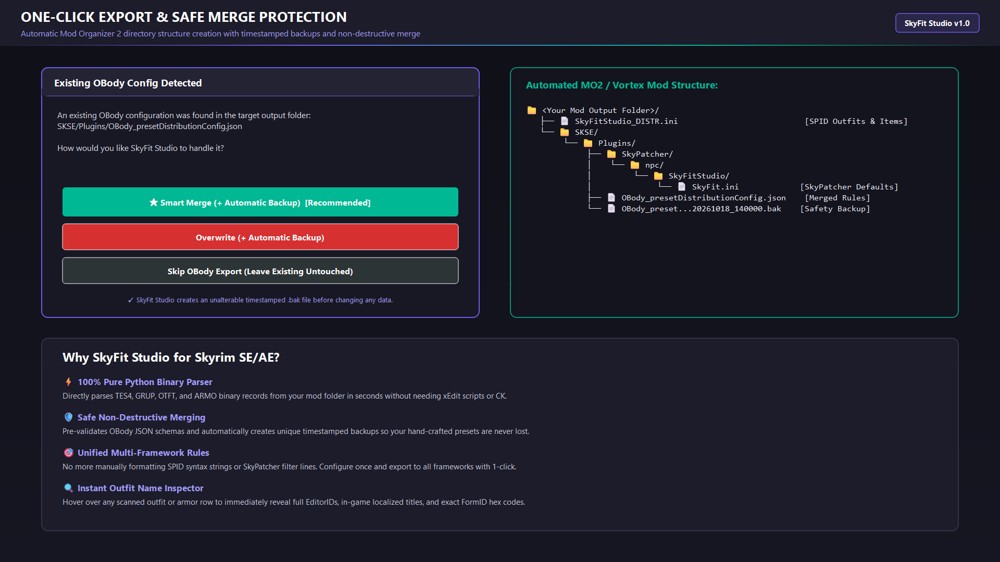

<p align="center"></p>

# SkyFit Studio

A desktop tool for Skyrim Special Edition that turns outfit mods into NPC outfit rules. Pick outfits from a mod, choose who should wear them, and SkyFit Studio writes the SPID, SkyPatcher and OBody files for you into a separate mod folder.



## Features

- **Browse any mod folder** and select outfits from its plugins.
- **Target Female, Male or Both.** For Both, the outfit must provide male and female models.
- **Three engines side by side:** review the SPID, SkyPatcher and OBody output on their own tabs before exporting.
- **Separate female and male OBody presets.** Scan your mods folder to find BodySlide presets; body and group metadata decides which presets fit women or men. Unrecognized presets are left out and counted in the scan summary. Choosing no preset leaves OBody's own random distribution in control.
- **Force ORefit:** outfits and nested leveled lists are resolved to verified armor IDs. Masters are searched in the scanned folder and your installed Skyrim Data folder; missing or unsupported entries are skipped with a visible notice.
- **Safe defaults:** global SkyPatcher rules are restricted to the `ActorTypeNPC` keyword. SPID supports chance rolls; SkyPatcher `outfitDefault` is deterministic, and strict mode skips rules below 100%.

| Hover name inspector | Engine comparison | Safe merge |
|---|---|---|
|  |  |  |

## Using it with Mod Organizer 2

Add SkyFit Studio to MO2's executable dropdown and launch it with your chosen profile. Browse a mod folder, select outfits, choose a target pool and Female / Male / Both, then add rules. Export to a separate mod folder and enable it in MO2.

Avoid enabling competing outfit assignments for the same NPCs from both SPID and SkyPatcher.

## Running from source

Requires Python 3.10+ on Windows.

```bash
pip install -r requirements.txt
python skyfit_studio.py
```

Keep `SkyFitStudio.ico` next to the script; the window icon is loaded from there.

## Building the exe

```bash
pip install pyinstaller
pyinstaller --noconfirm --windowed --name SkyFitStudio --icon SkyFitStudio.ico --add-data "SkyFitStudio.ico;." skyfit_studio.py
```

The build lands in `dist/SkyFitStudio/`. Ship `SkyFitStudio.exe` together with its `_internal` folder.

## Requirements in game

The files SkyFit Studio writes are used by these mods, so install the ones you export for:

- [Spell Perk Item Distributor (SPID)](https://www.nexusmods.com/skyrimspecialedition/mods/36869)
- [SkyPatcher](https://www.nexusmods.com/skyrimspecialedition/mods/106659)
- [OBody NG](https://www.nexusmods.com/skyrimspecialedition/mods/77016)
